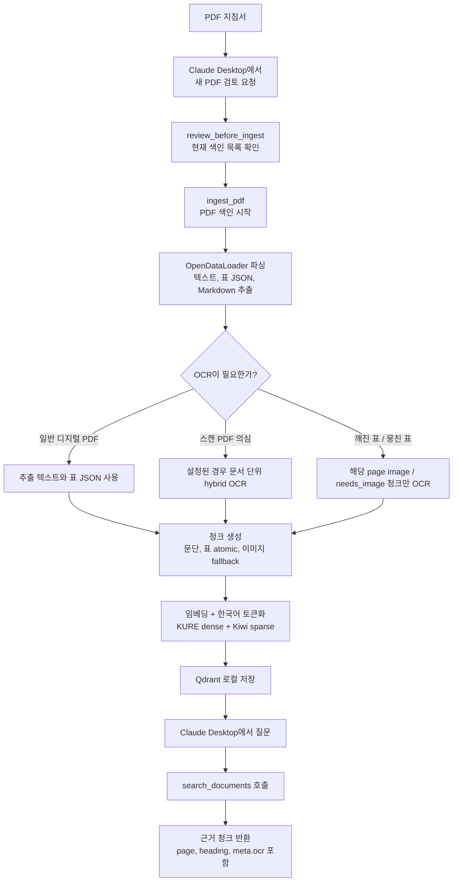

# RAG MCP

회계·예산 지침서 PDF를 로컬에서 색인하고, **Claude Desktop에서 질문으로 검색**할 수 있게 해 주는 MCP 서버입니다.

처음 한 번 설치하고 Claude Desktop에 연결해 두면, 이후에는 Claude Desktop에서 “2026년 예산 지침에서 일상경비 한도를 찾아줘”처럼 말로 요청해서 사용합니다.

OCR은 전체 PDF에 무조건 돌지 않습니다. 기본값에서는 스캔 PDF이거나 깨진 표처럼 텍스트 추출이 부족한 구간에서만 보강합니다.

## 전체 워크플로



## 빠른 설치 (Windows, 복붙 순서)

**명령은 한 줄씩** 복사해서 실행하세요. (아래 [설치 순서](#설치-순서)는 각 단계를 더 자세히 설명한 참고용입니다.)

> 이 과정은 **바탕화면에 `RAG MCP`라는 폴더**(원하면 다른 이름도 가능)를 만들고, 그 안에 코드를 내려받는 방식입니다. 폴더를 미리 손으로 만들 필요는 없고, 아래 2번의 `git clone` 명령이 **폴더까지 자동으로 만들어** 줍니다.

### 1. 도구 설치

**새 cmd 창**을 열고 아래를 한 줄씩 실행합니다.

```bat
winget install --id Git.Git -e
winget install --id Python.Python.3.11 -e
winget install --id astral-sh.uv -e
```

> 설치가 끝나면 **cmd 창을 닫고 새로 여세요.** 그래야 방금 설치한 `git`, `uv` 명령을 인식합니다.

### 2. 코드 받기 (바탕화면에 폴더 생성)

```bat
cd /d "%USERPROFILE%\Desktop"
git clone https://github.com/jang-hoil/rag-mcp.git "RAG MCP"
cd "RAG MCP"
```

- 첫 줄: 바탕화면으로 이동합니다.
- 둘째 줄: 바탕화면에 **`RAG MCP` 폴더를 새로 만들고** 그 안에 코드를 내려받습니다. 다른 이름을 쓰고 싶으면 맨 끝의 `"RAG MCP"`만 원하는 이름으로 바꾸세요 (예: `"내RAG"`). 그러면 그 이름의 폴더가 생깁니다.
- 셋째 줄: 방금 만들어진 폴더 안으로 들어갑니다.

### 3. 설치 (이 한 줄이 전부)

```bat
uv sync
```

> 처음에는 임베딩 모델을 받느라 몇 분 걸릴 수 있습니다. 한 번 받으면 다음부터는 빠릅니다.

### 4. Claude Desktop에 등록

먼저 `uv` 위치를 확인합니다.

```bat
where uv
```

Claude Desktop → **Settings → Developer → Edit Config**를 열고 아래를 붙여넣습니다. **굵게 표시한 두 곳만** 본인 값으로 바꾸세요.

```json
{
  "mcpServers": {
    "rag-mcp": {
      "command": "여기에 where uv 결과 경로",
      "args": [
        "--directory",
        "여기에 RAG MCP 폴더 경로",
        "run",
        "rag-mcp",
        "serve"
      ]
    }
  }
}
```

> 경로의 `\`는 **반드시 `\\`처럼 두 번** 씁니다. 예: `C:\\Users\\Owner\\Desktop\\RAG MCP`
>
> 이 두 경로를 바꾸는 방법은 아래 [4. 내 PC 경로가 다르면 바꿀 곳](#4-내-pc-경로가-다르면-바꿀-곳)에 그림처럼 자세히 나와 있습니다.

### 5. Claude Desktop 껐다 켜기 → 끝!

Claude Desktop을 **완전히 종료**하고 다시 실행하면 연결됩니다. 확인은 Claude Desktop에서 이렇게 물어보세요.

```text
collection_status 실행해서 상태 확인해줘.
```

---

## 설치 순서

아래 순서대로 한 번만 진행하면 됩니다. 설치와 연결은 터미널을 잠깐 쓰지만, 실제 사용은 Claude Desktop에서 합니다.

### 1. 준비물

| 프로그램 | 용도 |
|---|---|
| Python 3.11 | 프로젝트 실행용 Python |
| uv | Python 의존성 설치와 실행 |
| Git | GitHub 저장소 다운로드 |
| Claude Desktop | 실제로 질문하고 MCP 도구를 호출하는 앱 |

이 프로젝트는 Python 3.11 기준입니다. Python 3.13은 torch 계열 의존성 설치 문제가 생길 수 있어 권장하지 않습니다.

### 2. 프로젝트 다운로드

원하는 폴더에서 아래 명령을 실행합니다.

```bash
git clone https://github.com/jang-hoil/rag-mcp.git "RAG MCP"
cd "RAG MCP"
```

이미 이 저장소를 받아 둔 상태라면 프로젝트 폴더로 이동만 하면 됩니다.

```bash
cd "C:\Users\Owner\Desktop\RAG MCP"
```

### 3. Python 패키지 설치

```bash
uv sync
```

설치가 끝났는지 확인합니다.

```bash
uv run rag-mcp status
```

처음 실행할 때 KURE-v1 임베딩 모델이 HuggingFace에서 자동 다운로드될 수 있습니다. 한 번 받아지면 `~/.cache/huggingface`에 캐시됩니다.

### 4. OCR이 필요하면 추가 설치

디지털 PDF만 쓸 거라면 이 단계는 건너뛰어도 됩니다. 스캔 PDF나 깨진 표 구간까지 보강하려면 설치합니다.

```bash
uv sync --extra ocr
winget install --id UB-Mannheim.TesseractOCR
uv run rag-mcp doctor
```

`doctor` 결과에서 Tesseract 실행파일과 `kor`, `eng` 언어팩이 정상으로 나오면 OCR 준비가 끝난 것입니다.

## Claude Desktop에 연결하기

Claude Desktop은 MCP 서버를 설정 파일에 등록한 뒤 재시작해야 도구를 인식합니다.

### 1. 설정 파일 열기

Claude Desktop에서 아래 순서로 들어갑니다.

```text
Claude Desktop 실행
Settings 열기
Developer 메뉴 선택
Edit Config 클릭
```

그러면 보통 아래 파일이 열립니다.

```text
%APPDATA%\Claude\claude_desktop_config.json
```

직접 열고 싶다면 Windows 실행창이나 파일 탐색기 주소창에 위 경로를 넣어도 됩니다.

### 2. 설정 파일 작성

아래 형태로 작성합니다. **굵게 표시한 두 경로는 사람마다 다르므로 본인 PC 값으로 바꿔야 합니다.** (바꾸는 방법은 바로 아래 4번에서 설명합니다.)

```json
{
  "mcpServers": {
    "rag-mcp": {
      "command": "<여기에 uv.exe 경로>",
      "args": [
        "--directory",
        "<여기에 이 프로젝트 폴더 경로>",
        "run",
        "rag-mcp",
        "serve"
      ]
    }
  }
}
```

참고로, 이 저장소가 `C:\Users\Owner\Desktop\RAG MCP`에 있는 한 대의 PC에서는 실제로 아래처럼 채워집니다(어디까지나 **예시**입니다 — 본인 경로로 바꾸세요).

```json
{
  "mcpServers": {
    "rag-mcp": {
      "command": "C:\\Users\\Owner\\AppData\\Local\\Programs\\Python\\Python313\\Scripts\\uv.exe",
      "args": [
        "--directory",
        "C:\\Users\\Owner\\Desktop\\RAG MCP",
        "run",
        "rag-mcp",
        "serve"
      ]
    }
  }
}
```

> 위 예시 경로의 `Python313`은 단지 `uv.exe`가 설치된 위치일 뿐이며, 이 프로젝트가 실행에 쓰는 Python(3.11)과는 무관합니다. `uv`가 알아서 3.11 가상환경을 사용하므로 신경 쓰지 않아도 됩니다.

이미 다른 MCP 서버가 등록되어 있다면 전체 파일을 덮어쓰지 말고, `mcpServers` 안에 `rag-mcp` 항목만 추가합니다.

예시:

```json
{
  "mcpServers": {
    "existing-server": {
      "command": "...",
      "args": []
    },
    "rag-mcp": {
      "command": "C:\\Users\\Owner\\AppData\\Local\\Programs\\Python\\Python313\\Scripts\\uv.exe",
      "args": [
        "--directory",
        "C:\\Users\\Owner\\Desktop\\RAG MCP",
        "run",
        "rag-mcp",
        "serve"
      ]
    }
  }
}
```

### 3. 이 설정이 뜻하는 것

| 항목 | 쉬운 설명 |
|---|---|
| `rag-mcp` | Claude Desktop에 표시될 서버 이름 |
| `command` | RAG MCP를 실행할 `uv.exe` 위치 |
| `--directory` | 서버를 **이 프로젝트 폴더에서 실행**하라는 뜻. 색인 결과가 저장되는 `data\` 폴더도 여기에 생긴다 |
| `run rag-mcp serve` | MCP 서버를 켜라는 뜻 |

> **`--directory`가 색인 데이터(`data\`)의 위치를 정합니다.**
> 색인 결과는 PDF를 어디에 두었는지와 **상관없이** 항상 `--directory`로 지정한 프로젝트 폴더 안 `data\`에 생깁니다(PDF 경로는 "읽어올 원본 주소"일 뿐입니다).
> 엉뚱한 폴더를 적으면 색인이 거기 쌓여 "사라진 것처럼" 보이니, 반드시 이 프로젝트를 풀어둔 폴더를 적으세요.
> 무엇이 어디에 생기는지는 아래 [운영 주의사항](#운영-주의사항)을 참고하세요.

“stdio transport”는 사용자가 서버 창을 따로 켜 두는 방식이 아닙니다. Claude Desktop이 필요할 때 위 명령을 뒤에서 실행하고, Claude Desktop과 RAG MCP가 표준입출력으로 통신한다는 뜻입니다.

### 4. 내 PC 경로가 다르면 바꿀 곳

설정에서 바꿔야 하는 경로는 보통 2개입니다.

| 바꿀 값 | 무엇인지 |
|---|---|
| `command` | `uv.exe`가 설치된 위치 |
| `--directory` 다음 값 | 이 프로젝트 폴더 위치 |

#### `uv.exe` 경로 확인

터미널이나 PowerShell에서 아래 명령을 실행합니다.

```bash
where uv
```

예를 들어 이렇게 나오면:

```text
C:\Users\Owner\AppData\Local\Programs\Python\Python313\Scripts\uv.exe
C:\Users\Owner\.local\bin\uv.exe
```

둘 중 하나를 골라 `command` 값에 넣으면 됩니다. 보통 첫 번째 줄을 쓰면 됩니다.

단, JSON에서는 `\`를 `\\`처럼 두 번 써야 합니다.

| 터미널에 나온 경로 | JSON에 적는 값 |
|---|---|
| `C:\Users\Owner\AppData\Local\Programs\Python\Python313\Scripts\uv.exe` | `C:\\Users\\Owner\\AppData\\Local\\Programs\\Python\\Python313\\Scripts\\uv.exe` |

#### 내 PC에 맞게 바꾸기

아래 예시에서 보통 2곳만 바꾸면 됩니다.

```json
{
  "mcpServers": {
    "rag-mcp": {
      "command": "C:\\Users\\Owner\\AppData\\Local\\Programs\\Python\\Python313\\Scripts\\uv.exe",
      "args": [
        "--directory",
        "C:\\Users\\Owner\\Desktop\\RAG MCP",
        "run",
        "rag-mcp",
        "serve"
      ]
    }
  }
}
```

| 바꿀 곳 | 넣을 값 |
|---|---|
| `command` | `where uv`에서 나온 `uv.exe` 경로 |
| `--directory` 다음 줄 | 이 프로젝트 폴더 경로 |

`command`에는 `uv.exe` 경로만 넣습니다. `uv run rag-mcp serve` 같은 실행 명령 전체를 넣지 않습니다. 실행 옵션은 `args`에 나눠 넣습니다.

헷갈리면 `/`를 써도 됩니다. JSON에서는 아래처럼 적어도 정상입니다.

```json
{
  "mcpServers": {
    "rag-mcp": {
      "command": "C:/Users/Owner/AppData/Local/Programs/Python/Python313/Scripts/uv.exe",
      "args": [
        "--directory",
        "C:/Users/Owner/Desktop/RAG MCP",
        "run",
        "rag-mcp",
        "serve"
      ]
    }
  }
}
```

흔한 실수:

- `command`에 `where uv`라고 적지 않습니다. `where uv`는 경로를 찾는 명령입니다.
- `command`에 명령 전체를 적지 않습니다. `uv.exe` 경로만 적습니다.
- `C:\Users\...`처럼 `\`를 한 번만 쓰면 JSON 오류가 날 수 있습니다. `C:\\Users\\...`처럼 두 번 씁니다.

### 5. Claude Desktop 재시작

설정 파일을 저장한 뒤 Claude Desktop을 완전히 종료하고 다시 실행합니다.

작업 표시줄에 남아 있으면 완전히 꺼지지 않은 상태일 수 있습니다. 가능하면 Claude Desktop 창을 모두 닫고 다시 실행하세요.

## Claude Desktop에서 실제 사용하기

### 연결 확인

Claude Desktop에서 이렇게 물어봅니다.

```text
연결된 RAG MCP 도구로 collection_status를 실행해서 상태를 확인해줘.
```

정상이라면 컬렉션 이름, 문서 수, sparse 사용 여부 같은 상태가 나옵니다.

### PDF를 새로 넣을 때

PDF 파일은 아무 폴더에 두어도 됩니다. 경로만 알려주면 되고, 색인 결과는 PDF 위치와 무관하게 프로젝트 폴더의 `data\`에 저장됩니다.

먼저 현재 색인 목록을 확인합니다.

```text
이 PDF를 색인하기 전에 review_before_ingest로 현재 색인 목록을 먼저 보여줘.
PDF 경로는 C:\문서\2026_예산편성지침.pdf 이야.
```

목록을 보고 구버전을 삭제할지 판단한 뒤 색인을 시작합니다.

```text
이 PDF를 fiscal_year 2026으로 ingest_pdf 해줘.
진행 상태는 ingest_status로 확인해줘.
```

큰 PDF는 시간이 걸릴 수 있습니다. `ingest_pdf`는 바로 `job_id`를 반환하고, 실제 색인은 백그라운드에서 진행됩니다.

### 검색할 때

```text
list_documents에서 확인한 document_id가 `2026년 공직윤리 실무과정`인 지침에서
일상경비 한도를 찾아줘.
근거 페이지와 청크 내용을 같이 보여줘.
```

또는:

```text
document_id `pas_public_audit_info_system_manual_v1_01_2023`에서
201-01 일반수용비 관련 규정을 검색해줘.
```

Claude Desktop은 내부적으로 `search_documents` 도구를 호출해 결과를 가져옵니다.
검색은 문서별 sparse IDF를 사용하므로 `document_id`가 필수이며, 모르면 먼저
`list_documents`로 사용할 값을 확인합니다.

### 문서를 삭제할 때

삭제는 실수 방지를 위해 확인값이 필요합니다.

```text
list_documents로 색인된 문서를 보여줘.
그중 오래된 2025 예산편성지침 문서를 delete_document로 삭제해줘. confirm=True로 실행해.
```

## MCP 도구 목록

정해진 주문(키워드)이 있는 게 아닙니다. Claude가 아래 "이렇게 말한다"의 **의도**를 읽고 알맞은 도구를 골라 호출합니다. 확실하게 하려면 **하고 싶은 일 + (원하면) 도구 이름**을 같이 말하면 됩니다.

| 하고 싶은 일 | Claude Desktop에서 이렇게 말한다 | 불리는 도구 |
|---|---|---|
| 연결·상태 확인 | "collection_status 실행해서 상태 확인해줘" | `collection_status` |
| 새 PDF 넣기 전 점검 | "이 PDF 색인 전에 review_before_ingest로 현재 목록 보여줘. 경로는 `C:\문서\2026예산.pdf`" | `review_before_ingest` |
| PDF 색인 시작 | "이 PDF를 fiscal_year 2026으로 색인해줘. 경로는 `C:\문서\2026예산.pdf`" | `ingest_pdf` |
| 색인 진행 확인 | "방금 job_id로 진행 상태 확인해줘" | `ingest_status` |
| 검색(질문) | "document_id가 `2026 예산지침`인 문서에서 일상경비 한도 찾아줘. 근거 페이지도 같이" | `search_documents` |
| 문서 목록 보기 | "색인된 문서 목록 보여줘" | `list_documents` |
| 특정 청크 원문 | "이 chunk_id 원문 보여줘" | `get_chunk` |
| 문서 삭제 | "이 문서 삭제해줘, confirm=True로" | `delete_document` |
| 재색인 | "이 문서 reindex_document로 다시 색인해줘" | `reindex_document` |

> 큰 PDF 색인은 **2단계**입니다. `ingest_pdf`가 즉시 `job_id`만 돌려주고, 실제 색인은 백그라운드에서 진행됩니다. 그래서 "색인 시작 → job_id로 진행 확인"으로 나눠 말하게 됩니다.
> 삭제는 실수 방지를 위해 **`confirm=True`**를 함께 말해야 실제로 실행되며, 해당 문서의 Qdrant 컬렉션 전체를 제거합니다.

## OCR 동작 방식

기본값은 `RAG_OCR=auto`입니다.

| 상황 | 동작 |
|---|---|
| 일반 디지털 PDF | OpenDataLoader가 추출한 텍스트와 표 JSON을 그대로 사용 |
| 스캔 PDF로 의심되는 문서 | `RAG_ODL_HYBRID`가 설정된 경우 문서 단위 hybrid OCR 후보 |
| 깨진 표, 뭉친 표, 이미지 fallback 청크 | 해당 페이지 이미지 또는 `needs_image=True` 청크만 Tesseract OCR |
| OCR을 쓰지 않으려는 경우 | `RAG_OCR=off` |
| 이미지 fallback 청크를 강제로 OCR하려는 경우 | `RAG_OCR=force` |

즉, “필요시 OCR”은 전체 PDF를 매번 OCR한다는 뜻이 아니라 **스캔 문서 또는 깨진 표처럼 텍스트 추출이 부족한 구간만 보강한다는 뜻**입니다. OCR 적용 여부와 skip 사유는 manifest와 검색 결과의 `meta.ocr`에 남습니다.

## 터미널 명령어 요약

Claude Desktop 중심으로 사용할 때는 자주 쓰지 않아도 되지만, 점검할 때 유용합니다.

| 목적 | 명령 |
|---|---|
| 기본 설치 | `uv sync` |
| OCR 포함 설치 | `uv sync --extra ocr` |
| 상태 확인 | `uv run rag-mcp status` |
| OCR 환경 진단 | `uv run rag-mcp doctor` |
| 테스트 | `uv run pytest -q` |
| 직접 서버 실행 점검 | `uv run rag-mcp serve` |

`uv run rag-mcp serve`는 점검용입니다. Claude Desktop에 연결해서 쓸 때는 사용자가 직접 켜 둘 필요가 없습니다.

서버는 기동 시 임베딩 모델을 **백그라운드로** 미리 메모리에 올립니다(워밍업). 워밍업이 startup을 막지 않으므로 서버는 곧바로 연결(MCP initialize)에 응답하고, 콘솔(stderr)에는 `임베딩 모델 로딩 시작 → 로딩 완료 → 워밍업 완료 — 검색 준비됨` 로그가 순서대로 뜹니다(로딩에 약 10초 내외 소요). `워밍업 완료` 로그가 보인 뒤부터 검색이 콜드 스타트 지연 없이 즉시 응답하며, 그 전에 들어온 첫 검색은 그 시점에 모델을 로드합니다.

## 환경 변수

필요하면 `.env.example`을 `.env`로 복사해 조정합니다. 별도 API 키는 필요 없습니다.

| 변수 | 기본값 | 설명 |
|---|---|---|
| `RAG_DATA_DIR` | `./data` | 색인 산출물, Qdrant, manifest 저장 루트 |
| `RAG_QDRANT_MODE` | `local` | `local` 또는 `server` |
| `RAG_QDRANT_PATH` | `<RAG_DATA_DIR>/qdrant` | local 모드 저장 경로(미설정 시 `RAG_DATA_DIR` 아래에 생성) |
| `RAG_QDRANT_URL` | 없음 | server 모드 Qdrant URL |
| `RAG_EMBEDDING_MODEL` | `kure` | `kure` 또는 `bge_m3` |
| `RAG_BM25_K1` | `1.2` | 문서 sparse TF 포화 강도. 질의에는 적용하지 않음 |
| `RAG_BM25_B` | `0.75` | 문서 sparse 청크 길이 정규화 강도(0~1) |
| `RAG_MIN_DENSE_SCORE` | `0` | dense·hybrid 후보의 최소 코사인 유사도. `0`은 비활성 |
| `RAG_REL_SCORE_RATIO` | `0` | 1위 융합 점수 대비 최소 비율. `0`은 비활성 |
| `RAG_RERANKER` | `off` | `off`, 모델 없는 `lexical`, 로컬 모델 전용 `cross` |
| `RAG_RERANK_FETCH_K` | `30` | 리랭커에 넘길 융합 후보 수(1~100) |
| `RAG_CROSS_RERANKER_MODEL` | 없음 | `cross`에서만 쓰는 로컬 모델 경로. 자동 다운로드 안 함 |
| `RAG_RERANK_LEXICAL_WEIGHT` | `1.0` | 질의·본문 Kiwi 토큰 겹침 가중치 |
| `RAG_RERANK_HEADING_WEIGHT` | `0.5` | 질의·제목 경로 토큰 겹침 가중치 |
| `RAG_RERANK_TABLE_WEIGHT` | `0.2` | 표 의도와 `is_table` 일치 가중치 |
| `RAG_RERANK_AMOUNT_WEIGHT` | `0.3` | 금액 의도와 `has_amount` 일치 가중치 |
| `RAG_RERANK_CODE_WEIGHT` | `0.4` | 코드 의도와 `has_code` 일치 가중치 |
| `RAG_RERANK_LENGTH_WEIGHT` | `0.05` | 짧고 집중된 청크 선호 가중치 |
| `RAG_CHUNK_BOUNDARY_WINDOW` | `160` | 본문 800자 목표치 앞뒤의 문장 경계 탐색 범위 |
| `RAG_HF_OFFLINE` | `1` | `1`이면 임베딩 모델을 로컬 캐시에서만 로드(HF 네트워크 조회 차단). 정부망 등에서 검색이 멈추는 것을 막는다. 모델을 처음 받을 때만 `0`으로 두고 1회 다운로드 |
| `RAG_RENDER_DPI` | `200` | 표/페이지 이미지 렌더 DPI |
| `RAG_OCR` | `auto` | `off`, `auto`, `force` |
| `RAG_OCR_MIN_CHARS` | `30` | 스캔 PDF 판정 임계(페이지당 글자 수가 이 값 미만이면 빈약한 페이지) |
| `RAG_OCR_LANG` | `kor+eng` | Tesseract OCR 언어 |
| `RAG_ODL_HYBRID` | `off` | 스캔 PDF 문서 단위 hybrid OCR 사용 시 설정 (예: `hancom-ai`) |
| `RAG_ODL_HYBRID_URL` | 없음 | hybrid OCR 서버 URL (별도 기동 시) |

## 운영 주의사항

Qdrant local path 모드는 **동시에 하나의 프로세스만** 접근해야 합니다.

Qdrant 컬렉션은 임베딩 모델과 문서별로 분리됩니다. 이름은
`rag_<model>_<정규화된 document_id>_<원본 ID blake2b 6자리>` 형식이며,
문서별 sparse IDF 통계가 다른 지침의 어휘 빈도에 섞이지 않습니다.
신규 색인은 문서별 평균 청크 토큰 수(`avgdl`)를 매니페스트에 저장하고,
문서 sparse TF에 BM25 포화를 적용합니다. 질의 sparse는 raw TF를 유지합니다.

이 변경은 저장 벡터를 바꾸므로 **기존 1,077청크 색인에는 자동 반영되지 않습니다.**
원본 PDF 경로가 끊긴 문서가 있어 이번 변경에서는 재색인하지 않았습니다. 따라서
기존 색인과 신규 색인의 sparse 값이 다르며, 신규 색인부터 BM25 TF 포화가 적용됩니다.

관련도 필터는 기본값 `0`으로 비활성이라 기존 검색 결과를 바꾸지 않습니다.
`RAG_MIN_DENSE_SCORE`를 켜면 dense 또는 hybrid 검색에서 후보 dense 벡터의 코사인
유사도를 별도로 계산해 게이트로 사용합니다. **RRF 점수에는 절대 임계값을 적용하지
않습니다.** RRF 점수는 순위 산물이므로 관련도의 절대 척도가 아닙니다.
`RAG_REL_SCORE_RATIO`는 검색 방식과 관계없이 1위 융합 점수 대비 큰 낙폭을 제거합니다.
임계값 때문에 후보가 모두 제거되면 빈 배열 대신 필터 전 후보 수, 적용 임계값,
제거 원인을 담은 한국어 `diagnostic`을 반환합니다.

리랭커도 기본값은 `off`라 기존 융합 순서와 후보 수를 그대로 보존합니다.
`lexical`은 새 모델 없이 질의·본문·제목의 Kiwi 토큰 겹침, 표·금액·코드 의도,
청크 길이를 선형 결합해 `RAG_RERANK_FETCH_K` 후보를 재정렬합니다. dense와 sparse
점수를 직접 더하지 않고, Qdrant의 RRF/DBSF 융합 결과 뒤에서만 동작합니다.
`cross`는 선택 기능이며 `RAG_CROSS_RERANKER_MODEL`에 이미 존재하는 로컬 모델
경로를 지정해야 합니다. 경로가 없거나 모델을 열 수 없으면 한국어 오류를 내고
네트워크 다운로드는 시도하지 않습니다.

본문 청킹의 800자는 이제 하드 상한이 아니라 목표치입니다. 목표치 앞뒤
`RAG_CHUNK_BOUNDARY_WINDOW` 범위에서 가장 가까운 마침표·물음표·느낌표 또는
목록 표지(동그라미 숫자, 삼각형, 하이픈, 가운뎃점) 경계를 사용합니다. overlap도
가능하면 문장 경계에서 시작합니다. 목차처럼 탐색 창에 종결이 없으면 기존처럼
문자 수로 자르고, 본문 청크는 어떤 경우에도 목표치의 1.5배를 넘지 않습니다.
표는 기존 원칙대로 길이와 관계없이 atomic 청크 하나로 유지됩니다.

문장 경계 변경은 저장 청크 자체를 바꾸지만 **기존 3개 문서 1,077청크는 이번에
재색인하지 않았습니다.** 원본 PDF 2건의 경로가 끊겨 있기 때문입니다. 따라서 기존
색인과 신규 색인은 청크 경계와 sparse 값이 모두 다르며, 새 청킹은 신규 색인부터
적용됩니다.

`RAG_QDRANT_PATH`를 지정하지 않으면 저장 경로는 `<RAG_DATA_DIR>/qdrant`로 자동 결정됩니다. 한 서버 프로세스 안에서는 문서별 저장소가 같은 Qdrant 클라이언트 락을 공유하므로, 색인 중 검색·목록 조회가 들어와도 local 저장소 접근은 순서대로 실행됩니다. `ingest_pdf`는 전달한 PDF를 매번 새로 파싱한 뒤 색인하므로, 같은 경로의 변환 캐시가 남아 있어도 최신 PDF 내용으로 갱신됩니다. 색인 중에는 다른 변경 작업(`ingest_pdf`, `ingest_chunks`, `delete_document`, `reindex_document`)이 실행되지 않으며, 해당 도구는 현재 작업이 끝난 뒤 다시 시도하라는 `status="busy"` 응답을 반환합니다. 검색·조회 도구는 계속 사용할 수 있습니다.

Claude Desktop에 MCP로 연결해 쓰는 동안에는 다른 터미널에서 `uv run rag-mcp ingest`를 실행하지 마세요. PDF 색인은 Claude Desktop에서 `ingest_pdf`로 요청하는 것이 안전합니다.

서버 중복 실행은 서버가 스스로 방지합니다. Claude Desktop이 어떤 이유로 `serve`를 중복 spawn하면, 나중에 뜬 인스턴스는 저장소가 이미 사용 중임을 감지하고 `다른 인스턴스가 이미 실행 중입니다 — 이 인스턴스는 종료합니다(중복 방지)` 로그와 함께 스스로 종료합니다. 워밍업을 백그라운드로 돌려 startup 지연으로 인한 중복 spawn 자체도 줄였습니다. 따라서 색인이 멈추면 대개 서버를 수동으로 죽일 필요 없이 Claude Desktop 재시작만으로 정리됩니다.

또한 Claude Desktop이 서버를 켜 둔 동안에는 실행파일(`rag-mcp.exe`)이 잠겨 있어 다른 터미널의 `uv run ...`(예: `uv run pytest`)이 *파일이 사용 중* 오류로 실패할 수 있습니다. 이때는 Claude Desktop을 잠시 종료하거나, 가상환경 파이썬으로 직접 실행하세요: `./.venv/Scripts/python.exe -m pytest -q`.

### 기존 단일 컬렉션 이관

`scripts/migrate_to_per_doc_collections.py`는 기존 `rag_kure_chunks`의 dense/sparse
벡터와 payload를 그대로 읽어 문서별 컬렉션에 복사합니다. KURE 재임베딩은 하지
않으며 기본값은 쓰기 없는 dry-run입니다.

```powershell
# 1. Claude Desktop/MCP 서버를 완전히 종료하고 data/qdrant를 별도 백업
# 2. 청크 수만 검증(쓰기 없음)
uv run python scripts/migrate_to_per_doc_collections.py

# 3. dry-run의 669/370/38청크 확인 뒤에만 실제 복사
uv run python scripts/migrate_to_per_doc_collections.py --apply

# 4. MCP 서버를 다시 켜 list_documents와 collection_status에서
#    세 문서와 669/370/38청크를 확인한 뒤 서버를 다시 완전히 종료

# 5. 검증이 끝난 경우에만 레거시 단일 컬렉션 제거
uv run python -c "from rag_mcp.config import COLLECTION_BY_MODEL, Config; from rag_mcp.vector_store import open_qdrant_client; c=open_qdrant_client(Config()); name=COLLECTION_BY_MODEL['kure']; assert c.collection_exists(name), '레거시 컬렉션이 없습니다'; c.delete_collection(name); c.close()"
```

이관 대상은 `2026년 공직윤리 실무과정`,
`pas_public_audit_info_system_manual_v1_01_2023`,
`2025년_공직실무_재산등록(온라인용)`입니다.
삭제 확정된 `2025년_공직실무_윤리업무(온라인용)`과
`칠곡군청_2026 통합회계실무교재`는 새 컬렉션으로 복사하지 않습니다.
`rag_kure_chunks`는 이관 검증 전 복구용 원본이므로 먼저 지우지 마세요. 검증 뒤에도
남겨 두면 목록에는 표시되지 않지만 저장 공간을 계속 사용하므로 위 5단계로 정리합니다.
문서별 컬렉션이 없는 `document_id`를 검색하면 빈 결과 대신 이관이 필요하다는 오류를
반환합니다. 매니페스트도 없으면 `document_id` 확인 또는 신규 색인을 함께 안내하며,
두 경우 모두 dense 임베딩을 시작하기 전에 중단합니다.

### 프로젝트 전체 구조 (참고)

소스코드(◆ git 포함)와 색인 시 생성되는 산출물(✦ git 제외)이 한 폴더 안에 함께 있습니다. 다른 사람이 `git clone`하면 **◆만** 받고, ✦는 본인 PC에서 새로 생성됩니다(그래서 색인 데이터는 복제되지 않습니다).

```text
RAG MCP\                          ← 프로젝트 루트(= --directory)
│
├─ src\rag_mcp\                   ◆ 소스코드 (25개 모듈)
│   ├─ server.py                   FastMCP 진입점(도구 등록)
│   ├─ service.py                  도구 9개 비즈니스 로직
│   ├─ pipeline.py, pdf_parser.py, chunking.py, table_chunking.py   파싱·청킹
│   ├─ embeddings.py, sparse.py, tokenizer.py                       임베딩·한국어 토큰화
│   ├─ retrieval.py, vector_store.py                                검색·Qdrant
│   ├─ ocr.py, ocr_triage.py, page_render.py                        OCR
│   ├─ indexer.py, manifest.py, jobs.py, metadata.py, models.py     색인·상태·데이터모델
│   └─ config.py, request_models.py, cli.py, doctor.py, evaluation.py
│
├─ tests\                         ◆ 테스트
├─ eval\                          ◆ 평가용 데이터·스크립트
├─ README.md, CLAUDE.md, PROGRESS.md, MCP_연동가이드.md, AGENTS.md   ◆ 문서
├─ pyproject.toml, .env.example, .gitignore, uv.lock                ◆ 설정
│
├─ data\                          ✦ 색인할 때 생성 (git 제외)
│   ├─ parsed\{문서}\              파싱 캐시: json·md·문서 내 이미지·페이지 PNG·chunks
│   ├─ qdrant\                    검색용 벡터 저장소(모든 문서 공용)
│   └─ manifests\{문서}.json      색인 목록·상태 원장(list_documents가 읽는 곳)
│
├─ .venv\                         ✦ Python 가상환경(설치 시 1회 생성)
└─ .pytest_cache\                 ✦ 테스트 캐시
```

여기에 더해, 임베딩 모델은 **프로젝트 폴더 밖**(사용자 홈)에 받아집니다.

```text
C:\Users\{사용자}\.cache\huggingface\   ← 임베딩 모델 KURE-v1(수 GB)
```

> **`data\`만 생기는 게 아닙니다.** 임베딩 모델(수 GB)은 프로젝트 폴더가 아니라 **사용자 홈의 HuggingFace 캐시**에 받아집니다. 모든 프로젝트가 공유하므로 `--directory`나 `data\`를 바꿔도 그대로 남고, 첫 색인 때 한 번만 다운로드됩니다. 그래서 용량 정리한다고 `data\`만 지워도 모델(수 GB)은 그대로 남습니다.

`data\`의 위치는 [환경 변수](#환경-변수)의 `RAG_DATA_DIR`로 바꿀 수 있습니다(절대경로를 넣으면 실행 위치와 무관하게 한곳에 고정).

커밋하지 않는 재생성 산출물:

- `data/qdrant/`, `data/parsed/`, `data/manifests/`
- `*.pdf`, `*.png`
- `.cache/`, `.venv/`, `__pycache__/`, `.pytest_cache/`
- `.env`

## 참고 문서

- [MCP 사용자 빠른 시작](https://modelcontextprotocol.io/quickstart/user)
- [MCP_연동가이드.md](./MCP_연동가이드.md)

## 라이선스

이 프로젝트는 [MIT License](./LICENSE)로 배포됩니다.
